# Posters of what riemann-masullo's Lean formalisation of *The Music of the Primes* rests on

Forty-six generated SVG posters of
[riemann-masullo](https://github.com/mccorvie/riemann-masullo), the Lean formalisation of A. M. Masullo's
manuscript, at `MASULLO_COMMIT` = `72a10ff`. They have clickable links, adapt to light and dark, and are meant to
be opened on their own and zoomed.

Nothing here builds the Lean. The posters read riemann-masullo's `comparator.json`, `Main.lean`, `ERRATA.md`,
`paper/README.md` and its transcription of the manuscript, and [`src/deps.json`](src/deps.json): 21,342
declarations and what each uses, read by riemann-masullo's own `Deps.lean` from its compiled library, outside
this build ([tools/deps/README.md](../tools/deps/README.md)). A dependency is what the elaborated terms reach: a
fact about the Lean, not about the paper. The errata are reported and checked by AI agents; in ERRATA.md's words,
"No entry has been reviewed by a specialist."

## The posters

**Start here.**
- [M1](M1-floor-2026.11.25.svg) for what the seven targets rest on
- [M2](M2-no-repair-2026.11.25.svg) for the steps with no known repair
- [M4](M4-chapters-2026.11.25.svg) for the formalisation by chapter, and a link to every chapter poster
- [B1](B1-bibliography-2026.11.25.svg) for the works the manuscript cites

Four families; the table below names each poster.

- The formalisation as a whole: [M1](M1-floor-2026.11.25.svg), [M2](M2-no-repair-2026.11.25.svg),
  [M3](M3-depth-2026.11.25.svg), [M4](M4-chapters-2026.11.25.svg), [M5](M5-refuted-2026.11.25.svg)
- One module directory, item by item: [C1](C1-ch01-introduction-2026.11.25.svg) to
  [C14](C14-ch14-complements-2026.11.25.svg), [CA](CA-appa-algebraicnt-2026.11.25.svg) to
  [CE](CE-appe-topologicalstacks-2026.11.25.svg), [L1](L1-formathlib-2026.11.25.svg)
- The same directories, declaration by declaration: [D1](D1-ch01-introduction-2026.11.25.svg) to
  [D14](D14-ch14-complements-2026.11.25.svg), [DA](DA-appa-algebraicnt-2026.11.25.svg) to
  [DE](DE-appe-topologicalstacks-2026.11.25.svg), [DL](DL-formathlib-2026.11.25.svg)
- The manuscript's citations: [B1](B1-bibliography-2026.11.25.svg)

[](M1-floor-2026.11.25.svg)

| Id | Poster | What it shows | Reads |
|---|---|---|---|
| M1 | [What the seven target theorems rest on](M1-floor-2026.11.25.svg) | What the seven targets rest on: the one open declaration below them, its cone up to the targets, the rest by chapter. | comparator.json, Main.lean, ERRATA.md (the row of the floor, "Shown to be as strong as a target"), deps.json |
| M2 | [The steps with no known repair, and what the Lean shows of each](M2-no-repair-2026.11.25.svg) | The 28 rows of "Where no repair is known yet", by what the Lean shows of each; the chain to the nearest target; the open declarations no row names. | ERRATA.md (rows, its count of them, its sorting of the open rows, "Steps since proved"), deps.json |
| M3 | [The paper by depth below the targets](M3-depth-2026.11.25.svg) | The 1,251 paper items the docstrings name, by chapter and depth below the targets, with their state and their errata's Checked values. | ERRATA.md (every entry), deps.json |
| M4 | [The formalisation by chapter, and which chapters use which](M4-chapters-2026.11.25.svg) | The 20 module directories: their items, declarations, states, deviations, printed claims and errata, and which directories' items use which. | ERRATA.md (every entry), deps.json |
| M5 | [The printed claims the Lean refutes](M5-refuted-2026.11.25.svg) | The 312 refutations `Printed.<name>_false`, what each rests on, the entries that name them, and their Checked values against ERRATA.md's rule for "Lean". | ERRATA.md (every entry, every column), deps.json |
| C1 to C14, CA to CE, L1 | [Chapter 1 · `Ch01_Introduction`, item by item](C1-ch01-introduction-2026.11.25.svg) to [`ForMathlib`, file by file](L1-formathlib-2026.11.25.svg) | One module directory each, item by item: a band per module, a card per item, with the items it uses and is used by. | ERRATA.md (every entry), deps.json |
| D1 to D14, DA to DE, DL | [Chapter 1 · `Ch01_Introduction`, declaration by declaration](D1-ch01-introduction-2026.11.25.svg) to [`ForMathlib`, declaration by declaration](DL-formathlib-2026.11.25.svg) | The same directories, declaration by declaration: every declaration of each item, with kind, file, line and state, and its `Deviation:` line quoted. | deps.json |
| B1 | [The works the manuscript cites, and where](B1-bibliography-2026.11.25.svg) | The manuscript's bibliography, entry by entry, with a link to each work and the pages that cite it, each opening the card that covers it. | transcription/README.md, transcription/chapters/ (the bibliography and every chapter), deps.json, src/papers.toml |

The chapter posters are laid out by [`src/chapter.py`](src/chapter.py) and the declarations posters by
[`src/declarations.py`](src/declarations.py); each `src/d_c*.py`, `src/d_d*.py`,
[`src/d_l1_formathlib.py`](src/d_l1_formathlib.py) and [`src/d_dl_formathlib.py`](src/d_dl_formathlib.py) holds
one directory's literals.

In the light theme the page behind the cards is `#e8e8e8`, 90.8% white, the mean luminance of M1's content;
[PAGE.md](PAGE.md) records how that was measured and how to measure it again.

## Where the content comes from

Each sentence on a poster is one of four kinds:

- quoted: in italics, or in a table column headed "quoted", from a file the footer names. A chapter card's italic
  line is the first sentence of its first declaration's docstring, after the `Paper:` reference, and is the
  Lean's, not the manuscript's.
- computed: a template filled at build time.
- framing: titles, keys, "How to read it", "What this does not say".
- an interpretation: in an amber card headed as the poster's own, and guarded by a check. M1 has one, guarded by
  `FLOOR` and `AS_STRONG`, and M5 one, guarded by `SUMMARY` and `LEAN_UNNAMED`.

B1's entries are the bibliography's, as riemann-masullo's transcription prints them: a work's authors, title,
venue and year, drawn as bibliographic data under rule 9 ([PLAN.md](../PLAN.md)), not the manuscript's prose,
which no poster quotes. The PDF is never read; the build checks its hash as `paper/README.md` states it. The link
to each work is this repository's own, from [`src/papers.toml`](src/papers.toml): the transcription records the
citation, not the link.

## What is checked

Each poster is a module `src/d_<id>_<slug>.py` with `ID`, `SLUG` and `build()`. It reads everything through
[`src/rm.py`](src/rm.py)'s `load()`, records what it expects the sources to say as module-level literals, and
raises an error, with both values and what to re-read, when they say otherwise.

Before any poster, `rm.load()` checks that:

- the checkout is at `MASULLO_COMMIT`, with no local change to the files read;
- `paper/README.md` gives `PAPER_SHA256` and no other hash;
- `deps.json` has `DEPS_SHA256`, and it and [`tools/deps/meta.json`](../tools/deps/meta.json) were read at
  `MASULLO_COMMIT`;
- `Main.lean` declares exactly the theorems comparator.json names, each closed;
- ERRATA.md's "Where no repair is known yet" has its four columns, and the rows read agree with the file's own
  sentence counting them ("Sixteen of the twenty-eight rows…", "The twelve that are still open").

Then each poster, against its literals:

| Poster | Expectation | Fails when |
|---|---|---|
| M1 | `TOTALS` | the declarations in deps.json, the open ones, their `Gap:` and `Classical input:` lines, or the vendored ones change in number |
| | `TARGETS` | comparator.json names other targets |
| | `FLOOR` | a target rests on another set of open declarations |
| | `N_BELOW` | the number of declarations, project or vendored, below a target changes |
| | `ROW` | the floor is named by another open row of ERRATA.md, or by none |
| | `CONE`, `EXPECTED` | a declaration or an edge appears in or leaves the floor's cone |
| | `BY_CHAPTER` | the closure's counts by chapter move |
| | `AS_STRONG` | "Shown to be as strong as a target" names other theorems, or one now rests on something open |
| M2 | `GAPS` | an open row names another set of open declarations (recorded by hand, each traced to the row's line) |
| | `CONES` | an open step's cone, the targets it reaches, or whether it stays in `_Isolated` files changes |
| | `CLASSES` | an open row moves between groups; also checked against ERRATA.md's own sorting ("For four of the twelve…", "For two more", "The remaining six", "(one, three and one)") |
| | `SETTLED` | a settled row's "Steps since proved" names other theorems, or what they rest on moves |
| | `UNNAMED` | another open declaration is named by no open row, or the lines naming one move; and each such must be a classical input |
| | `CHAINS` | the shortest chain from an open step to the nearest target changes |
| | `ERRATA_PAPERS` | a paper that an entry's row of ERRATA.md links, on a row's entries, appears, goes, moves to another address or to other entries |
| M3 | `N_ITEMS`, `EXPECTED_DEPTHS`, `COUNTS`, `CHAPTERS` | the items, their depths, states or chapters move |
| | `ERRATA`, `UNPLACED` | the entries placed on items, by Checked value, or those placed on none, move |
| M4 | `TOTALS` | a directory's modules, items, declarations, open or resting items, deviating items, printed claims or errata entries change in number |
| | `MATRIX` | the uses between two directories' items change in number |
| M5 | `REFUTED` | a refutation appears or goes, the entries that name it or their Checked values change, or what is open below it moves |
| | `SUMMARY`, `LEAN_UNNAMED` | the entries naming a refutation change by Checked value and state, or an entry checked "Lean" names none; and an entry checked "Lean" whose refutation rests on something open fails the build outright |
| | `ERRATA_PAPERS` | a paper that an entry's row of ERRATA.md links, on the entries naming a refutation, appears, goes, moves to another address or to other entries |
| C*, L1 | `ITEMS` | an item appears in, leaves or moves between the bands of the directory |
| | `EXPECTED` | an edge between two items of the directory appears or goes, after the redundant ones are dropped |
| | `OUTSIDE` | an item's direct uses of another directory's items change in number |
| | `STATES`, `DEVIATIONS`, `ERRATA` | an item's state, its count of deviating declarations, or the entries on it change |
| | `CITES` | the works the manuscript cites on an item's pages change |
| | `ERRATA_PAPERS` | a paper that an entry's row of ERRATA.md links, on the entries on an item, appears, goes, moves to another address or to other entries |
| D*, DL | `DECLS` | a declaration appears in, leaves or moves between items, or changes its place in its file |
| | `DEVIATING` | a declaration gains or loses its `Deviation:` line |
| | `OUTSIDE_ITEMS` | an item's direct uses of another directory's items change |
| B1 | `REFERENCES` | an entry of the bibliography appears, goes, or moves in the order printed |
| | `CITED`, `UNCITED` | a work is cited on other pages or chapters, or by no bracketed key |
| | `SP_TAGS` | the Stacks project's tags cited (`[SP, Tag 000B]`), or the pages citing one, change |
| | (papers.toml) | an entry has no id in the papers file, an id names no entry, or an entry lacks a url, a via, or the note `hand` and `none` need |

The build also fails if:

- a poster is not well-formed XML, or leaves markup unrendered;
- an `id` is drawn twice on one poster, or an anchor is not an XML name or collides with the poster's own ids;
- a link to a poster names no target on it, a card that poster does not draw, or a poster the manifest does not
  list;
- a link out is not at the pin, is not a paper an entry's row of ERRATA.md links, and is not one of
  [`src/papers.toml`](src/papers.toml);
- a character is not in the embedded fonts (see [Fonts](#fonts));
- two texts overlap, a text leaves the canvas, or a word is wider than its table cell.

What is not checked: a quotation cut before a character the fonts lack is marked as abridged, and its name opens
the full text (one `Deviation:` line, which writes `⁻³ᐟ²`); the counts in [`README.md`](../README.md) and this
file are written by hand, and no build compares them; the page grey ([`PAGE.md`](PAGE.md)) is measured, not
enforced; and M2's grouping of a row rests on the declarations the row names in code, so a row that names its
step only in prose is "not stated" here.

## Links

Every poster links to the others, so that a reader can follow an item from any poster to its card and to the
source.

| From | To |
|---|---|
| Every poster | the overviews, M1 to M5, by the line under the title; M4 lists every chapter poster |
| A Lean name in code | its declaration's line in riemann-masullo at the pin |
| A chapter card's title | the item's first declaration at the pin |
| A chapter card's count of declarations, and of deviations | the item's table, and its quoted `Deviation:` lines, on the declarations poster |
| A declarations block's heading | the item's card on the chapter poster |
| A card's "Uses" and "Used by" | the cards they name, on the same poster |
| "From other directories" | the used item's card when it is one item; else that directory's row of the item's "Uses of other directories" on the declarations poster, whose items open their cards |
| An errata entry id, or a row's line | its line of ERRATA.md at the pin |
| A key in a card's "Its pages cite" | that work's row on B1 |
| A page in B1's "Where the text cites it" | the card on that chapter's poster whose `Paper:` pages cover it, the one with fewest pages where several do |
| A chapter in B1's "Where the text cites it" | that chapter's poster |
| A link in B1's Link column | the work, at the address `src/papers.toml` gives |
| A tag in B1's row of [SP] | that tag's page on the Stacks project, when it has a tag's form (four characters, digits and capital letters) |
| An arXiv number after an entry, or a card's "Papers the errata link" | the paper, at the address the entry's row of ERRATA.md gives (unversioned: arXiv opens its latest version) |
| "Printed claims kept" | that directory's part of M5 |
| An open or resting item | the row of M2 that names its open declaration (or that declaration's card on M2), and M1's card of the floor where the floor is below it |
| A declaration card on M1 or M2, a refutation on M5, a dot on M3 | the item's card on its chapter poster |
| A directory on M4, a row of M3 or M5, the line under a title | the poster's title block, `top` |

A card is an anchor (`i-<kind>-<number>`, from `items.anchor`); a declarations poster's blocks are `d-…` and their
deviations `v-…`; M5's directories are `refuted-<directory>`. Every link to a poster names a target on it.

The target of a link stands out when it is opened: each anchored group has an amber frame behind it, and each
anchored table row (M2's rows, `row-<line>`; the declarations posters' `o-<item>--<directory>`) is framed itself,
hidden until the address names it (CSS `:target`), when it shows and pulses three times. It works where a browser
opens the SVG itself, as on the Pages site, from a release or from a file. GitHub's file viewer, and an `` as
above, show an SVG as an image, without its links or this style, and a renderer without CSS keeps the frame
hidden.

A link to another poster is made only to an anchor the committed [`manifest.json`](manifest.json) lists, so the
relative links resolve in the tree, on the Pages site and among a release's assets alike. Links into
riemann-masullo are absolute, and at `MASULLO_COMMIT`, never a branch, so that a link from an old release stays
true.

## Regenerating

```bash
uv run python diagrams/gen-diagrams.py        # all; or: uv run python diagrams/gen-diagrams.py M1 M2
```

[`gen-diagrams.py`](gen-diagrams.py) writes `<ID>-<slug>-<date>.svg` and [`manifest.json`](manifest.json). It
needs only the standard library, on Python 3.12 or later: `sum()` over floats changed in 3.12, and with it the
coordinates. The output is deterministic: unchanged inputs give unchanged bytes, so a diff in an SVG after
regenerating means riemann-masullo or `deps.json` has moved under a poster. Any `WARNING` or `ERROR` line is a
failure, and the exit status is 1. After a change, look at the result in both themes:
`tools/look.sh OUT_DIR diagrams/M1-*.svg` renders each poster given in light and dark with headless Chrome.

The links between posters are resolved against the committed `manifest.json`. When a run moves a poster's anchors
it updates the manifest, prints a `NOTE`, and exits 1: run it again, so that the links of every poster follow. A
run whose anchors did not move needs no second run.

To move the posters to a newer riemann-masullo, bump `MASULLO_COMMIT` in [`src/rm.py`](src/rm.py), and
`PAPER_SHA256` if `paper/README.md` names another draft; rebuild `deps.json` at the new commit, outside this build
([tools/deps/README.md](../tools/deps/README.md)), and set `DEPS_SHA256` to its hash; then regenerate, and fix
whatever the checks report by recording what the sources now say.

The source is expected as a sibling checkout, `../riemann-masullo`; `RIEMANN_MASULLO` points elsewhere.

## In CI

`.github/workflows/posters.yml` checks out riemann-masullo at `MASULLO_COMMIT`, regenerates every poster with
Python 3.12, and fails if the generator prints a `WARNING` or `ERROR`, if any committed file under `diagrams/`
differs from the regenerated one, or if a poster is regenerated that is not committed. So a pull request that
moves a pin without regenerating fails, and one that regenerates passes. riemann-masullo is checked out sparse,
with only the seven paths `rm.READS` names.

A release is an annotated version tag. `.github/workflows/release.yml` runs the same check on the tag, then
publishes the SVGs with `pins.json` and `SHA256SUMS`, and `.github/workflows/pages.yml` serves that release's
posters at https://scottcochran.github.io/riemann-masullo-diagrams/, with this file, rendered, as its index. The site
holds one release at a time.

## Files

| File | What it is |
|---|---|
| [`gen-diagrams.py`](gen-diagrams.py) | the generator; writes the posters and `manifest.json` |
| [`manifest.json`](manifest.json) | each poster's file, title, cards, arrows and anchors; the registry the links between posters are resolved against |
| [`src/rm.py`](src/rm.py) | the pins and the reader |
| [`src/draw.py`](src/draw.py) | the shared drawing: a declaration card, a layered graph, a chain, a quotation |
| [`src/items.py`](src/items.py) | the paper items: declarations grouped as the progress map groups them, their state, deviations, errata and uses, and the dropping of redundant edges |
| `src/d_m1_floor.py` … `src/d_m5_refuted.py` | M1 to M5, each holding its literals |
| [`src/chapter.py`](src/chapter.py) | the chapter posters' layout and checks; each `src/d_c*.py` and [`src/d_l1_formathlib.py`](src/d_l1_formathlib.py) holds one directory's literals |
| [`src/declarations.py`](src/declarations.py) | the declarations posters' layout and checks; each `src/d_d*.py` holds one directory's literals |
| [`src/paper.py`](src/paper.py) | the transcription of the manuscript: its bibliography, and where its text cites each entry |
| [`src/d_b1_bibliography.py`](src/d_b1_bibliography.py) | B1, with its literals |
| [`src/papers.toml`](src/papers.toml) | the link to each work of the bibliography, and how it was found, written by [`tools/link-papers.py`](../tools/link-papers.py); this repository's own data |
| [`src/deps.json`](src/deps.json) | the derived dependency data, pinned by `DEPS_SHA256` |
| [`src/lib.py`](src/lib.py), [`src/metrics.py`](src/metrics.py), [`src/fonts/`](src/fonts/) | the drawing library, widths and fonts, from riemann-diagrams ([NOTICE](../NOTICE)) |
| [`PAGE.md`](PAGE.md) | the light page's grey, and its measurement |

## Fonts

Every poster carries its fonts: Noto Sans (regular, bold, italic) for the text, Noto Sans Mono (regular, bold) for
code and Lean, and Noto Sans Math for the symbols the other two lack. Each is subset to the characters of `WANT`
in `tools/build-fonts.py` (Noto Sans Math to those the others lack) and embedded as WOFF2 in the poster's
`<style>`, about 176 KB of base64 per poster, so that a poster looks the same on every machine.

[`src/metrics.py`](src/metrics.py) holds the advance width of every character in every face, so that text is
wrapped and boxed at the width the browser draws it; kerning and ligatures are left out of the subsets to keep
that exact. A character outside the subsets is a `WARNING`, which fails the posters check, rather than a silent
fallback to a system font.

[`tools/build-fonts.py`](../tools/build-fonts.py), copied from riemann-diagrams with nine characters more, writes
`src/fonts/*.woff2` and `src/metrics.py` from the Noto sources in google/fonts, pinned by commit and SHA-256 in
the script. It needs fontTools and Brotli; the generator does not, since it only base64-encodes the committed
files. Run it to add characters (its `WANT`) or change a face, then regenerate the posters:

```
uv run --with fonttools==4.68.0 --with brotli==1.2.0 python tools/build-fonts.py SRC_DIR
```

The fonts are under the SIL Open Font License 1.1, Copyright 2022 The Noto Project Authors
([`src/fonts/OFL.txt`](src/fonts/OFL.txt)); each WOFF2 file keeps that notice in its name table.

## Attribution

[NOTICE](../NOTICE) gives each in full.

* **The formalisation** [riemann-masullo](https://github.com/mccorvie/riemann-masullo) and its authors wrote the
  Lean declarations, their docstrings (`Paper:`, `Gap:`, `Classical input:` and `Deviation:` lines, and their
  descriptions), `ERRATA.md` and `comparator.json`, which the posters draw and quote, under that project's
  Apache-2.0 licence. `src/deps.json` is derived from it, by its own `Deps.lean`. Code it vendors under
  `RiemannMasullo/External/` keeps its own licence; the posters count those declarations and draw none of them.
* **The manuscript**, A. M. Masullo, *The Music of the Primes* (draft of 2026-11-20), belongs to its author, and
  riemann-masullo's transcription of it is not covered by that project's licence. No poster copies or quotes the
  manuscript's text; B1 draws its bibliography's entries as the transcription prints them.
* **The works the bibliography lists** belong to their authors and publishers. B1 links to them; none is copied
  or read here.
* **riemann-diagrams** gave the drawing library [`src/lib.py`](src/lib.py) (itself TOPAK's, Apache-2.0),
  [`src/metrics.py`](src/metrics.py), the font subsets, `tools/build-fonts.py` and `tools/measure-page.py`, at its
  commit `f87256e`, copied and not imported.
* **The Noto fonts** every poster embeds are Copyright 2022 The Noto Project Authors, under the SIL Open Font
  License 1.1.

A poster here says what the Lean formalisation rests on, at one commit. It says nothing about whether the
manuscript or the formalisation is correct.
